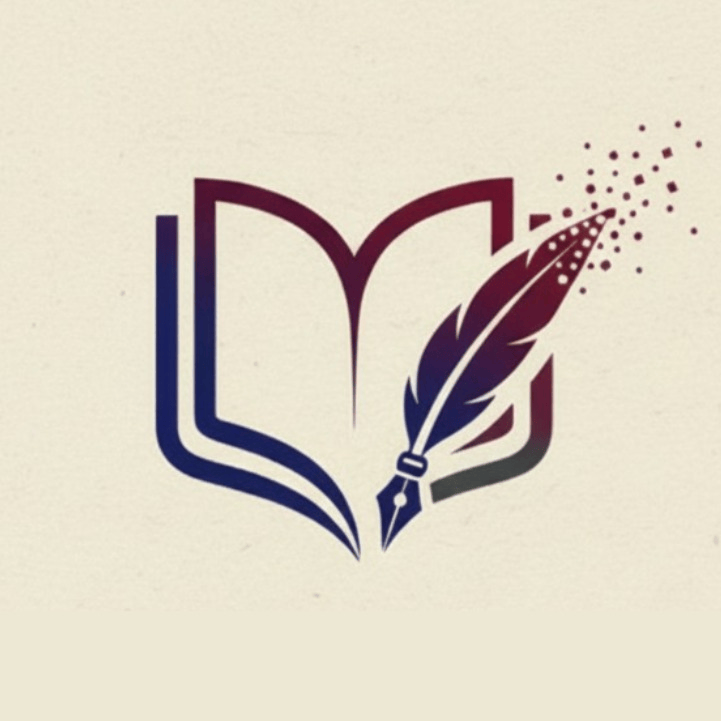

# ✒️ NovaScriptum

**Академические тексты, которые не стыдно показать.**

Рефераты, доклады, презентации, курсовые и дипломы — с ясной ценой,
нормальными сроками и человеком на связи, а не ботом-автоответчиком.

---

## Знакомая история

Дедлайн через три дня. Тема есть, материалов нет. В поисках исполнителя ты пишешь пятерым, ждёшь ответа, слышишь «скиньте требования» и «цена договорная» — и в итоге теряешь вечер на переписку вместо работы.

**NovaScriptum** устроен иначе: цена видна сразу, заказ оформляется за пару минут, а дальше с тобой говорит живой человек, который ведёт твою работу до конца.

---

## Что мы делаем

| Услуга | Что получаете |
| :--- | :--- |
| **Реферат** | Работа по вашей теме: план, основная часть, заключение, список литературы |
| **Доклад / Эссе** | Текст для выступления, семинара или письменной сдачи |
| **Презентация** | Слайды с тезисами и визуалом под ваш доклад или защиту |
| **Курсовая** | Смета фиксируется до оплаты, оплата один раз за весь объём |
| **Диплом** | Крупный проект по этапам: каждый считается и оплачивается отдельно |

---

## Цены

| Услуга | Объём | Стоимость |
| :--- | :--- | ---: |
| Реферат | 12–15 листов | **450 ₽** |
| Доклад / Эссе | 5–7 листов | **350 ₽** |
| Презентация | 7 слайдов | **250 ₽** |
| — каждый дополнительный блок | +5 слайдов | +50 ₽ |
| Курсовая работа | по вашему ТЗ | рассчитывается индивидуально |
| Дипломная работа | три этапа | рассчитывается индивидуально |

Никаких «от 500 ₽» и звёздочек мелким шрифтом. Цифра на сайте — та же цифра в счёте.

---

## Как заказать

**1. Выберите работу на сайте.** Отметьте нужные позиции — корзина посчитает сумму, включая количество слайдов.

**2. Оформите заказ в Telegram.** Перейдите в бота, приложите тему и требования. Администратор уточнит детали и выставит счёт.

**3. Оплатите онлайн.** Платёж проходит через защищённый сервис Platega.io — картой или другим удобным способом.

Дальше остаётся ждать: работа приходит в тот же чат, где вы оформляли заказ.

---

## Что входит в цену

- **Две бесплатные корректировки** — если замечания в рамках изначального задания.
- **План и структура** — согласуем до того, как написан текст.
- **Список литературы** — оформленный, по вашим требованиям.
- **Срочные заказы** — да, можно, с наценкой +40 % к базовой цене.
- **Связь с исполнителем** — до сдачи работы, а не «написал и пропал».

---

## Почему к нам возвращаются

**Цена без сюрпризов.** Стоимость фиксируется до оплаты. Если объём меняется — сначала согласуем, потом делаем.

**Сроки реальные.** Мы не обещаем диплом за ночь. Срок зависит от объёма, и мы говорим его прямо.

**Разговор по-человечески.** Без «уважаемый заказчик» и шаблонных ответов. Пишете в Telegram — отвечает тот, кто ведёт ваш заказ.

**Конфиденциальность.** Тема, требования и переписка не уходят третьим лицам.

---

## Отзывы

Не наши слова, а слова тех, кто уже заказывал:

**[@NovaScriptum_feedback →](https://t.me/NovaScriptum_feedback)**

---

## Написать нам

- **Telegram, заказы:** [@NovaScriptum_admin](https://t.me/NovaScriptum_admin)
- **Канал проекта:** [@NovaScriptum](https://t.me/NovaScriptum)
- **WhatsApp:** [+7 993 307-93-73](https://wa.me/79933079373)
- **Почта:** [evgenyzaratuchenko@gmail.com](mailto:evgenyzaratuchenko@gmail.com)
- **ВКонтакте:** [vk.ru/novascriptum](https://vk.ru/novascriptum)
- **Instagram:** [@NovaScriptum_official](https://instagram.com/NovaScriptum_official)

---

Услуги оказываются в информационно-консультационных целях. 
Материалы не являются аттестационными работами и не предназначены для сдачи без самостоятельной переработки. 
Полные условия — в <a href="oferta.html">публичной оферте</a>.

